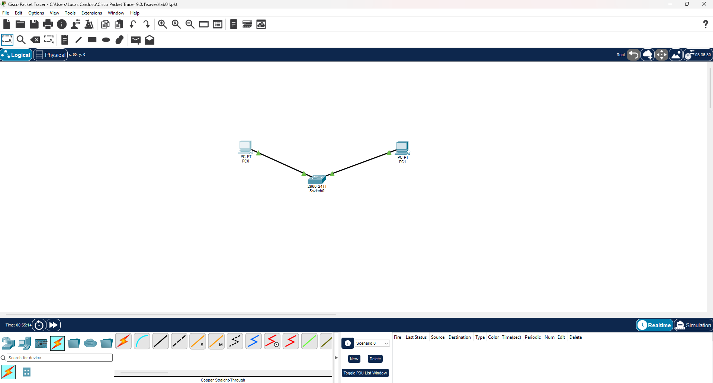

# Lab 01 - Rede Básica com Switch e Endereçamento IPv4

## 🎯 Objetivo
Configurar uma topologia simples de rede local (LAN) conectando 2 hosts a um switch central, atribuindo IP estático e testando a conectividade de ponta a ponta.

## 🗺️ Topologia


## 🔢 Tabela de Endereçamento

| Dispositivo | Interface | Endereço IP  | Máscara de Sub-rede | Gateway Padrão |
| :---        | :---      | :---         | :---                | :---           |
| PC-A        | FastEth0  | 192.168.1.10 | 255.255.255.0       | N/A            |
| PC-B        | FastEth0  | 192.168.1.20 | 255.255.255.0       | N/A            |
| Switch-01   | VLAN 1    | 192.168.1.2  | 255.255.255.0       | N/A            |

## 💻 Comandos Utilizados

### Configuração inicial do Switch (CLI)
```
enable
configure terminal
hostname Switch-01
interface vlan 1
 ip address 192.168.1.2 255.255.255.0
 no shutdown
end
write memory
```

## ✅ Testes Realizados
(colar aqui o print dos pings)

- PC-A → PC-B:
- PC-A → Switch-01:
- PC-B → Switch-01:

## ❓ Perguntas
1. Por que não precisamos de gateway nesta topologia?
2. O que o switch faz com o endereço IP da VLAN 1?
3. O que significa a máscara /24?

## 📚 O que aprendi
(com suas palavras)
