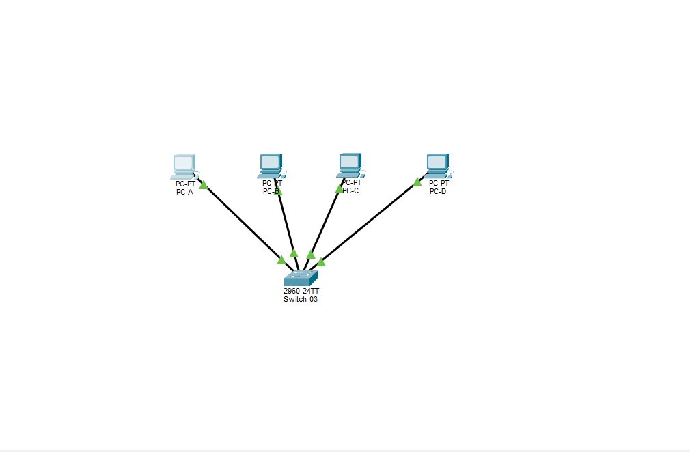

# Lab 03 - VLANs

## 🎯 Objetivo
Criar duas VLANs em um switch e verificar na prática que dispositivos em VLANs diferentes não se comunicam, mesmo estando na mesma rede IP.

## 🗺️ Topologia



## 🔢 Plano de VLANs

| VLAN | Nome | Portas | Dispositivos |
| :--- | :--- | :--- | :--- |
| 10 | FINANCEIRO | Fa0/1, Fa0/2 | PC-A, PC-B |
| 20 | TI | Fa0/3, Fa0/4 | PC-C, PC-D |

## 🔢 Tabela de Endereçamento (rede 192.168.1.0/24, sem gateway)

| Dispositivo | IP | Máscara | VLAN |
| :--- | :--- | :--- | :--- |
| PC-A | 192.168.1.10 | 255.255.255.0 | 10 |
| PC-B | 192.168.1.20 | 255.255.255.0 | 10 |
| PC-C | 192.168.1.30 | 255.255.255.0 | 20 |
| PC-D | 192.168.1.40 | 255.255.255.0 | 20 |

## 💻 Comandos Utilizados

```
enable
configure terminal
hostname Switch-03
vlan 10
 name FINANCEIRO
exit
vlan 20
 name TI
exit
interface range fastEthernet 0/1 - 2
 switchport mode access
 switchport access vlan 10
exit
interface range fastEthernet 0/3 - 4
 switchport mode access
 switchport access vlan 20
end
write memory
```

Verificação: `show vlan brief`


## ✅ Testes Realizados

- PC-A → PC-B (mesma VLAN 10): respondeu


- PC-A → PC-C (VLANs diferentes): 100% de perda (timeout)


- Teste extra: movendo a porta Fa0/1 para a VLAN 20, o ping PC-A → PC-C passou a funcionar. Ao devolver a porta para a VLAN 10, o timeout voltou.


## 📚 O que aprendi
- VLAN divide o switch em redes virtuais isoladas.
- Dispositivos em VLANs diferentes não se comunicam, mesmo com IP e máscara compatíveis.
- Quem pertence a uma VLAN é a porta do switch. Para mudar um PC de VLAN, muda-se a porta.
- Timeout pode ter causas diferentes: no Lab 02 era endereçamento (sub-redes diferentes), aqui é isolamento no switch (VLANs diferentes).
- Para comunicar VLANs diferentes, é preciso um roteador (próximo laboratório).
