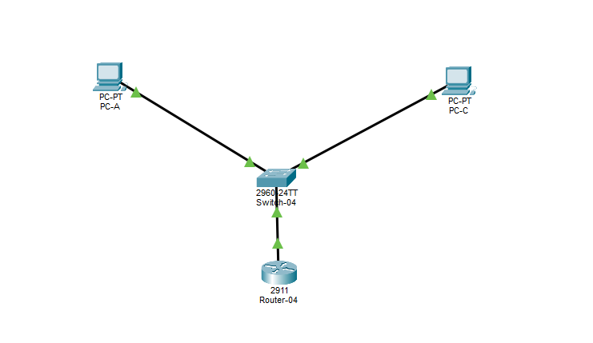

# Lab 04 - Roteamento entre VLANs (Router-on-a-stick)

## 🎯 Objetivo
Permitir a comunicação entre duas VLANs usando um único cabo entre o switch (porta trunk) e o roteador (subinterfaces).

## 🗺️ Topologia


## 🔢 Plano de VLANs e endereçamento

| VLAN | Nome | Rede | Gateway (subinterface) | Dispositivo | IP |
| :--- | :--- | :--- | :--- | :--- | :--- |
| 10 | FINANCEIRO | 192.168.10.0/24 | 192.168.10.1 | PC-A | 192.168.10.10 |
| 20 | TI | 192.168.20.0/24 | 192.168.20.1 | PC-C | 192.168.20.10 |

| Switch-04 | Função |
| :--- | :--- |
| Fa0/1 | Acesso, VLAN 10 (PC-A) |
| Fa0/2 | Acesso, VLAN 20 (PC-C) |
| Gig0/1 | Trunk, ligado ao Router-04 (Gig0/0) |

## 💻 Comandos Utilizados

### Switch-04
```
enable
configure terminal
hostname Switch-04
vlan 10
 name FINANCEIRO
exit
vlan 20
 name TI
exit
interface fastEthernet 0/1
 switchport mode access
 switchport access vlan 10
exit
interface fastEthernet 0/2
 switchport mode access
 switchport access vlan 20
exit
interface gigabitEthernet 0/1
 switchport mode trunk
end
write memory
```

### Router-04
```
enable
configure terminal
hostname Router-04
interface gigabitEthernet 0/0
 no shutdown
exit
interface gigabitEthernet 0/0.10
 encapsulation dot1Q 10
 ip address 192.168.10.1 255.255.255.0
exit
interface gigabitEthernet 0/0.20
 encapsulation dot1Q 20
 ip address 192.168.20.1 255.255.255.0
end
write memory
```

## ✅ Verificação

`show interfaces trunk` (Switch-04):


`show ip interface brief` (Router-04):


## ✅ Testes Realizados

- PC-A → PC-C (VLANs diferentes, passando pelo roteador): respondeu (o primeiro pacote falhou por causa do ARP)


## 🛠️ Problema encontrado
O trunk não subia (`Operational Mode: down` na Gig0/1). O cabo do roteador estava ligado na Fa0/3 em vez da Gig0/1. Após religar na porta correta, o `show interfaces trunk` passou a mostrar a Gig0/1 como trunking.


## 📚 O que aprendi
- VLANs diferentes só se comunicam por meio de um roteador.
- Router-on-a-stick usa um cabo só: a porta do switch é trunk e a interface física do roteador é dividida em subinterfaces.
- Cada subinterface usa `encapsulation dot1Q <VLAN>` e o IP dela é o gateway daquela VLAN.
- O TTL diminui 1 a cada roteador (128 → 127), o que prova que o pacote passou pelo roteador.
